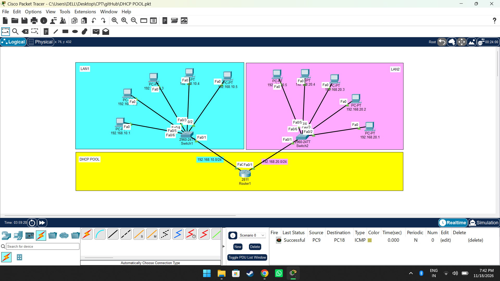

# DHCP-pool-two-lans-packet-tracer
Cisco Packet Tracer lab: Cisco router as a DHCP server with separate address pools for two LANs, tested with inter-LAN connectivity.
# DHCP Server with Multiple Pools on a Cisco Router (Cisco Packet Tracer)

## Overview
This project configures a Cisco 2811 router as a **DHCP server** for two separate LANs. Each LAN has its own address pool, so PCs get an IP address, subnet mask, default gateway and DNS server automatically. The router also routes traffic between the two LANs.

## Topology


## Network Design

| Section | Colour | Network | Details |
|---------|--------|---------|---------|
| LAN1 | Cyan | 192.168.10.0/24 | Switch1 (2960) with 5 PCs, connected to Router1 Fa0/0 |
| LAN2 | Pink | 192.168.20.0/24 | Switch2 (2960) with 5 PCs, connected to Router1 Fa0/1 |
| DHCP server | Yellow | Router1 (2811) | Two DHCP pools, one per LAN, plus inter-LAN routing |

## DHCP Pools

| Pool | Network | Default Gateway | Excluded Addresses |
|------|---------|-----------------|--------------------|
| LAN1 | 192.168.10.0/24 | `[gateway IP]` | `[excluded range]` |
| LAN2 | 192.168.20.0/24 | `[gateway IP]` | `[excluded range]` |

## Technologies Used
- DHCP server on a Cisco router
- Multiple DHCP pools
- Excluded address ranges for the gateway and static devices
- Inter-LAN routing
- IP addressing and subnetting
- Cisco 2811 router and 2960 switches

## Objectives
- Configure two DHCP pools on one router
- Exclude the gateway addresses from the pools
- Set PCs to obtain their addresses automatically (DHCP)
- Verify that each PC gets an address from the correct pool
- Confirm connectivity between the two LANs

## Verification
- `show ip dhcp pool` to view pool details and usage
- `show ip dhcp binding` to see which PC received which address
- `show ip route` to check connected networks
- `ipconfig` on a PC to confirm IP, mask, gateway and DNS
- Ping from a PC in LAN1 to a PC in LAN2 (successful, as seen in the PDU list)

## Sample Configuration
```
ip dhcp excluded-address 192.168.10.254
ip dhcp excluded-address 192.168.20.254

ip dhcp pool LAN1
 network 192.168.10.0 255.255.255.0
 default-router 192.168.10.254
 

ip dhcp pool LAN2
 network 192.168.20.0 255.255.255.0
 default-router 192.168.20.254
```

## How to Open
Download the `.pkt` file (or the zip) and open it in Cisco Packet Tracer.

## Result
All PCs in both LANs receive IP addresses automatically from the router's DHCP pools and can communicate across LANs.
